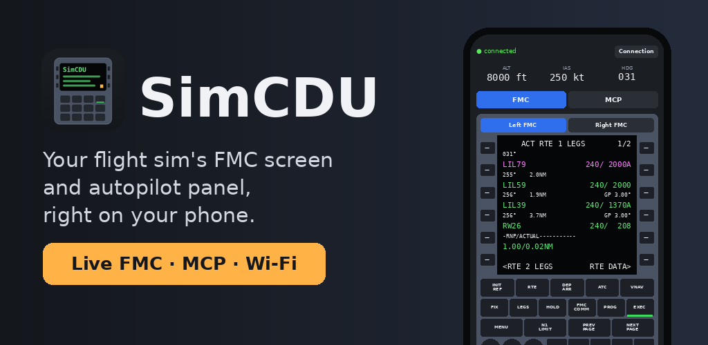
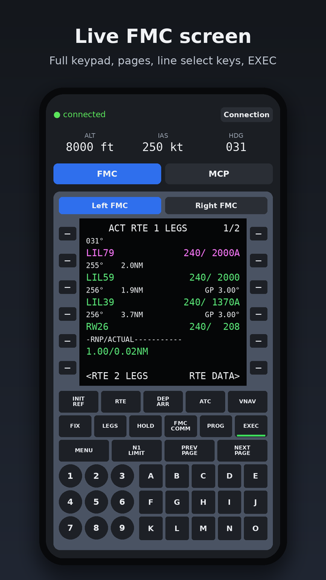
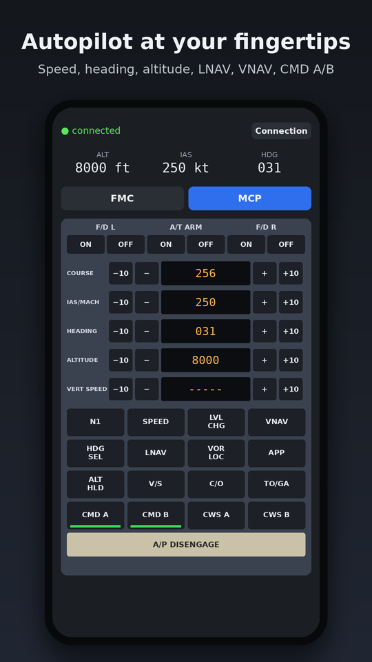
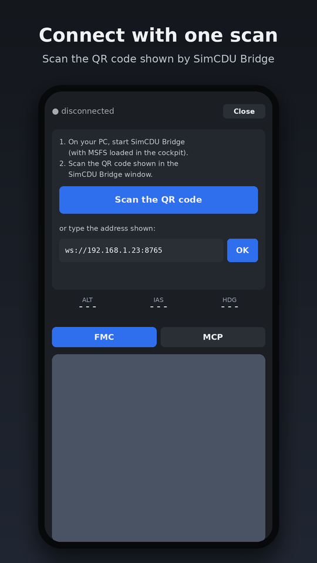

# SimCDU – 737 MAX FMC (CDU), MCP and overhead panel on your phone (MSFS 2024)

| Live FMC screen | Autopilot (MCP) | Connect with one scan |
| :---: | :---: | :---: |
|  |  |  |

## Download

- **Android app**: [Google Play](https://play.google.com/store/apps/details?id=com.lab.simcdu)
- **PC companion (SimCDU Bridge)**: [download the latest installer](https://github.com/GUILLALAB/simcdu/releases/latest)
  (file `SimCDU-Bridge-Setup.exe`)

## Installation

1. Run **SimCDU-Bridge-Setup.exe** and follow the wizard. The Windows firewall is configured automatically.
2. Install the free **MSFS 2024 SDK**, required for the FMC, MCP and overhead panel:
   in MSFS, Options > General > Developers > Developer Mode, then in the top bar **Help > SDK Installer**.
   SimCDU Bridge finds the SDK wherever it is installed (or asks you once where it is).

## Usage

1. Start MSFS and load a flight in the default Boeing 737 MAX cockpit.
2. Open the **Windows Start menu** (Windows key), type **SimCDU**, and launch **SimCDU Bridge**. A QR code is displayed.
3. In the app: **Connection > Scan the QR code**. The app remembers the address and reconnects automatically.
4. For the live FMC screen, pop out the CDU in MSFS: **Right Alt + click** on the CDU screen.

## Troubleshooting

- **"MSFS not found"**: normal until a flight is loaded in the cockpit; SimCDU Bridge retries automatically.
- **"MSFS 2024 SDK not found"**: install the SDK (see above).
- **"Port 8765 is already in use"**: SimCDU Bridge is already running; close the other window.
- **The app does not connect**: phone and PC must be on the same Wi-Fi network.
- **Windows SmartScreen warning**: click "More info", then "Run anyway" (the installer is not code-signed).

## Privacy

SimCDU collects no personal data. See the [privacy policy](https://guillalab.github.io/simcdu/privacy-en.html).

## Disclaimer

SimCDU is an independent project, not affiliated with Microsoft, Asobo Studio or Boeing.
Names are trademarks of their respective owners and are used only to indicate compatibility.
